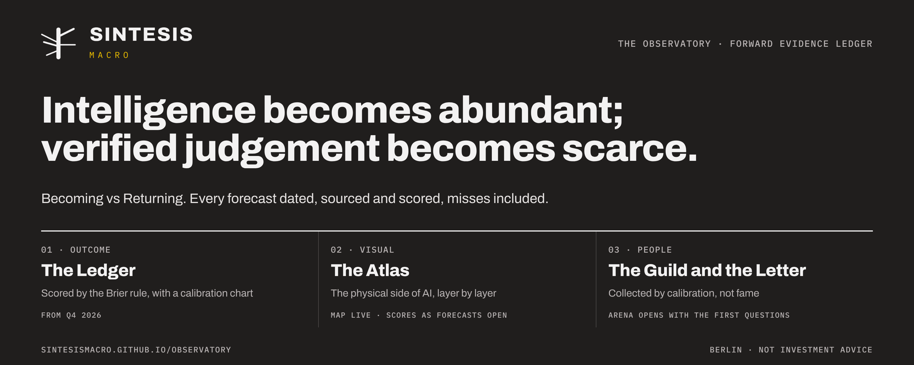

# SINTESIS

We verify judgement, starting with our own. Every forecast we make is dated, sourced, scored and
independently timestamped, and the misses stay in.

**[Open the Observatory →](https://sintesismacro.github.io/observatory/)** Test your calibration on
fourteen resolved questions, walk the Atlas of the physical layers of AI and meet the thinkers
behind the rules.

## Three paths, one record

| | Path | What it is | Status |
| --- | --- | --- | --- |
| 01 | **[The Ledger](https://github.com/sintesismacro/ledger)** · outcome | Every forecast dated, sourced and scored, misses included, with a live scorecard and calibration chart. | Live; first forecasts planned for December 2026 |
| 02 | **[The Atlas](https://sintesismacro.github.io/observatory/#atlas)** · visual | The physical side of AI (compute, power, grid, cooling, robotics), with a Becoming and a Returning score per layer, redrawn from the Ledger. | Map live; scores fill as forecasts open |
| 03 | **[The Guild and the Letter](https://sintesismacro.github.io/observatory/#guild)** · people | People collected by calibration, not fame; a quarterly letter merged as a pull request. | Arena opens with the first questions; [Letter 0](https://github.com/sintesismacro/ledger/blob/main/letters/2026-10-letter-0.md) out now |

**[The Physical AI Collection](https://github.com/sintesismacro/physical-ai-collection)**: open-source
projects across the ten layers, each opened and checked by hand, collected by judgement, not by
fame.

## Becoming vs Returning

Every thesis carries two voices before it carries a number. **Becoming**, after Spinoza:
intelligence extends as a body (fabrication, power, grid, cooling, actuators), and that body is
priced first. **Returning**, after Mainländer: every necessity removed consumes something, and every
edge moves toward its own extinction. The probability is where the two meet. The
[ledger](https://github.com/sintesismacro/ledger) shows who was right.

## What we do for funds

SINTESIS is a research and technology company based in Germany. For professional trading
organisations that must answer for their research, we deliver independent, timestamped evidence
on their own hypotheses, and the operating system to act on it.

| Layer | What it does |
| --- | --- |
| **Macro Investor** | Regime assessment, probability-weighted scenarios, priced-in checks and an event calendar, in a weekly Macro Brief with a calibration record. |
| **Fundamental Investor** | Thesis cards with every claim tagged as fact, assumption, estimate or inference, plus expectations-gap analysis, scenario valuation and post-investment review. |
| **Quant Risk Manager** | Beta and factor estimation, pre-trade risk tickets, stress tests, limit monitoring and attribution. Nothing is credited to skill until the residual has been investigated. |
| **PM / CIO** | Integrates the three inputs and sets the risk budget, with decision records, a weekly risk meeting and quarterly reporting. |

Each role is built as a set of skills plus independent challenger agents (devil's advocate,
regime challenger, risk challenger, integration reviewer). The challengers read only the record,
never the conversation that produced it.

## Principles

- Start from risk, not expected outcome.
- Treat volatility, liquidity, correlation and regime as state variables.
- Separate thesis quality from timing quality, and skill from luck.
- Prefer robustness to fragile optimisation. Reject false precision.
- A stop verdict is a full deliverable. Most ideas should stop.

## Research

Working papers are pre-registered before any result is published. The first paper is
forthcoming and will be announced here and on the website.

## Contact

- Website: [sintesismacro.com](https://www.sintesismacro.com)
- Email: <office@sintesismacro.com>

Not investment advice. No issuer or security is named in SINTESIS public material. Prepared 22 October 2026 · Revised 24 October 2026
